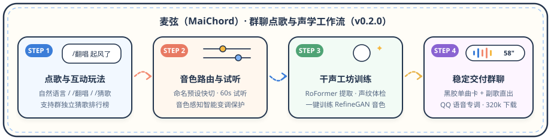

<div align="center">
  

  <br>
  
  <h1>麦弦 (MaiChord)</h1>
  <p>给 MaiBot 用的本地 AI 翻唱插件，带清唱猜歌和侧边栏调音台。</p>

  <p>
    
    
    
    
  </p>

  <p>
    <a href="https://allure-gui.github.io/feiyu-cover-plugin/" target="_blank">在线试听（《雨爱》）</a>
    &nbsp;·&nbsp;
    <a href="https://github.com/Allure-Gui/feiyu-cover-api">配套翻唱 API 仓库</a>
    &nbsp;·&nbsp;
    <a href="https://github.com/Allure-Gui/feiyu-cover-api/blob/main/TRAINING_GUIDE.md">部署与炼丹指南</a>
    &nbsp;·&nbsp;
    <a href="CHANGELOG.md">更新日志</a>
  </p>
</div>

<p align="center">
  
</p>

<div align="center">
  
</div>

<br>

> [!NOTE]
> 这个插件只跑在 MaiBot 这边，负责点歌、猜歌、排行榜、发语音和侧边栏界面。真正干活的人声分离、RVC 换声和训练在独立的 **[feiyu-cover-api](https://github.com/Allure-Gui/feiyu-cover-api)**（需要 `v0.3.0+`）里跑。
>
> - **有 8GB 以上 N 卡**：直接在自己电脑装 API 就行，平时不点歌显存占用是 **0 MB**，插件设置里打开「自动拉起本地服务」后用完也会自己退。
> - **没独显 / 多台机器共用**：可以把 API 扔到远程 GPU 机器上，插件里填地址和密钥连过去。

<p align="center">
  
</p>

## 能干嘛

- **点歌翻唱**：群里或私聊直接喊「唱一首大鱼」「唱首雨爱」，或者用 `/翻唱 <歌名/BV号>`。等不及了可以直接喊取消。默认切全曲最好听的 **58 秒副歌**发语音条，顺带附一张黑胶单曲卡（自动读你麦麦的名字）。QQ 这边专门调了防忽大忽小的母带，Telegram 等其他平台保留 44.1kHz 高音质。
- **清唱猜歌 & 群排行**：发 `/猜歌` 放 15 秒无伴奏清唱，群友用 `/猜 <歌名>` 抢答，答不上来就 `/揭晓答案`。猜中了马上解锁 58 秒带伴奏副歌，顺便给群里记分（一次猜中 +3、二次 +2、多次 +1，按群分开存），发 `/猜歌排行榜` 出 TOP 5 榜单图。本地还没缓存过歌的话，会自动从热歌池现学一首，大概 15~20 秒开局。
- **侧边栏「麦弦」工作室**：
  - **音色路由**：切模型、存预设、调变调/贴合度/辅音保护，支持直接导入外面 RVC WebUI 或 Applio 导出的 `.pth` / `.zip` 模型；右边能看显存占用、手动释放显存和清缓存。
  - **试听工坊**：直接搜多平台音源选版本，支持 **60 秒极速试听**，听满意了点一下「应用到路由」，也能存本地 320k MP3 或直接推到指定群聊。
  - **干声工坊**：输入歌名、BV 号或本地路径就能用 RoFormer 提干声，做完可以跑个声纹体检和一键去静音，达标了直接后台训练（支持 RefineGAN 32k 和 HiFi-GAN 40k，最高 800 轮）。
- **杂项细节**：设置页里可以单独关掉猜歌或桌宠联动，也能按群聊/私聊配黑白名单。多平台（QQ OneBot / QQ 官方 / Telegram / 微信 ClawBot / 内置聊天）都测过兼容。

<p align="center">
  
</p>

## 安装和配置

### 1. 装插件
- **下压缩包**：去 [Releases](https://github.com/Allure-Gui/feiyu-cover-plugin/releases) 下最新版源码包，解压到 MaiBot 的 `plugins/` 目录，文件夹改名叫 **`feiyu_cover`**，进插件管理刷新启用。
- **用 Git**：
  ```bash
  cd <MaiBot根目录>/plugins
  git clone https://github.com/Allure-Gui/feiyu-cover-plugin.git feiyu_cover
  ```
- **插件市场**：在 MaiBot 插件市场搜 **麦弦** 安装。

> [!TIP]
> 覆盖更新的时候留好原来的 `config.toml` 和 `data/plugins/feiyu.voice-cover/` 目录，里面存着你的音色预设、路由设置和猜歌积分。另外 `plugins/` 下面别留两份副本，不然会报插件 ID 冲突。

### 2. 连上翻唱 API
打开 MaiBot WebUI → **插件 → 麦弦设置**：
1. `服务地址` 默认就是 `http://127.0.0.1:19655`（连远程就改这里，顺便填上两边一致的 `访问密钥`）。
2. API 装在本机的话，把 **`自动拉起本地服务`** 和 **`卸载时自动关闭`** 打开，**`API 文件夹路径`** 填你放 `feiyu-cover-api` 的目录（比如 `D:\feiyu-cover-api`，不填也会自己找常见路径）。
3. 玩法开关和黑白名单按自己群里的情况调。
4. 点右上角 **保存**，再点设置页顶上的 **「一键检测 / 拉起服务」**，看到状态变绿就通了。

> Windows 下不用自己折腾 `wsl.exe` 启动命令，插件会自动识别原生一键包（`runtime/service-venv`）或者本机的 WSL2 发行版，卸载插件时也会顺手把拉起的服务关干净。

### 3. 选音色
点左侧边栏 **「麦弦」**：
- **音色路由**：选一个模型（或者点旁边的「导入模型」把自己现成的 `.pth` / `.zip` 导进来），打开「智能变调」，点「保存并生效」就行。
- **试听工坊**：搜首歌开「极速试听（60秒）」听听效果，满意就点「应用到路由」。
- **干声工坊**：想自己练声音的话，在这里提干声、体检、开训一条龙。

<p align="center">
  
</p>

## 速度和常用参数

### 实测耗时（搭配 API `v0.3.0` + Mel-Band RoFormer）

| 机器情况 | 首次整曲（3~4 分钟） | 60 秒试听 / 现学猜歌 | 复用分离缓存换音色 |
|---|---|---|---|
| **NVIDIA 8GB 显卡（比如 RTX 4060 Ti）** | 30 ~ 45 秒 | 15 ~ 20 秒 | 5 ~ 10 秒 |
| **纯 CPU** | 5 ~ 20 分钟 | 2 ~ 6 分钟 | 2 ~ 5 分钟 |
| **远程 GPU 服务器** | 30 ~ 45 秒 + 上传下载 | 15 ~ 20 秒 + 上传下载 | 5 ~ 10 秒 + 上传下载 |

### 我自己常用的调音参数

| 参数 | 干嘛用的 | 建议值 |
|---|---|---|
| **智能变调 (`auto_pitch`)** | 自动看模型舒适音域和原唱高音来选半音，伴奏跟着移调 | **打开**（开着时手动滑块会锁灰，想手调就关掉它） |
| **音色贴合 (`index_rate`)** | 越高越像训练原声，太高容易带电音 | `RefineGAN`：`0.50 ~ 0.65`；`HiFi-GAN`：`0.25 ~ 0.35` |
| **辅音保护 (`protect`)** | 护住咬字和气口，防止吞字或刺耳 | **`0.45`** |
| **音量包络 (`volume_envelope`)** | 越小越跟着原唱的强弱起伏，太大容易把底噪放大 | **`0.25`** |
| **基频算法 (`f0_method`)** | 提取原唱音高曲线 | **`rmvpe`** |
| **人声空间混响 (`vocal_reverb`)** | 给干声加一点点房间感，不然贴在伴奏上很生硬 | **打开** |
| **共振峰偏移 (`formant_shifting`)** | 调声音厚薄，但多一步重采样会损一点清晰度 | 默认 **关闭** |

<details>
<summary><b>config.toml 配置项 & 对接的 API 接口列表</b></summary>

<br>

#### `config.toml`（样例看 [`config.example.toml`](config.example.toml)）

| 配置项 | 默认值 | 说明 |
|---|---|---|
| `[plugin].enabled` | `true` | 插件开关 |
| `[cover].api_base` | `http://127.0.0.1:19655` | API 地址 |
| `[cover].api_key` | 空 | Bearer 密钥（连远程建议填） |
| `[cover].auto_start_api` | `false` | 离线时自动后台拉起本地 API |
| `[cover].api_dir` | 空 | 本地 `feiyu-cover-api` 目录，留空自动找 |
| `[cover].api_runtime` | `auto` | `auto`（自动）/ `wsl` / `local` |
| `[cover].auto_stop_api` | `false` | 插件卸载时关掉自己拉起的服务 |
| `[cover].deliver_mode` | `highlight` | `highlight`（58秒副歌）/ `two_parts`（前两段×60秒） |
| `[cover].send_cover_card` | `true` | 唱完附带黑胶单曲卡 |
| `[cover].cooldown_seconds` | `600` | 同一个人点歌冷却（秒） |
| `[cover].poll_interval` | `10` | 轮询任务间隔（秒） |
| `[cover].max_wait_seconds` | `1800` | 最长等待（秒） |
| `[cover].notify_progress` | `true` | 接单时在群里回一句提示 |
| `[cover].cache_deliver_delay` | `3` | 命中缓存时稍等几秒再发，显得自然点 |
| `[cover].api_start_cmd` / `api_stop_cmd` | 空 | *(隐藏高级项)* 需要完全自定义启停命令时才用 |
| `[features].enable_quiz` | `true` | 开/关清唱猜歌和排行榜 |
| `[features].enable_desktop_pet` | `true` | 开/关桌宠联动 |
| `[scope].allow_group` / `allow_private` | `true` / `true` | 群聊 / 私聊总开关 |
| `[scope].group_list_mode` / `group_list` | `off` / 空 | 群聊不限制 / 白名单 / 黑名单 |
| `[scope].private_list_mode` / `private_list` | `off` / 空 | 私聊不限制 / 白名单 / 黑名单 |

> 路由参数、预设和猜歌积分都在 `data/plugins/feiyu.voice-cover/` 下面（`voice.json`、`voice_presets.json`、`quiz_scores.json`）。

#### 调用的 API 接口（`feiyu-cover-api >= v0.3.0`）

```text
GET  /health                     健康检查
GET  /models                     可用模型列表
POST /models/import              本机路径导入外部 .pth / .zip / 文件夹
POST /models/upload              浏览器拖拽上传外部模型
GET  /models/import-page         外部模型拖拽上传页
GET  /sources/search             多平台搜歌
POST /cover                      提交翻唱任务
GET  /jobs/{id}                  查进度
POST /jobs/{id}/cancel           取消任务
GET  /jobs/{id}/voice-info       查分段数
GET  /jobs/{id}/voice-part/{i}   下载第 i 段语音（支持 for_qq=1）
GET  /jobs/{id}/highlight        58 秒副歌 / 15 秒清唱（vocals_only=1 / for_qq=1）
GET  /jobs/{id}/audio            下载完整 320k MP3
GET  /system/status              GPU 显存与 RVC 状态
POST /system/unload              释放 RVC 显存
GET  /cache/stats                缓存统计
POST /cache/clean                清理缓存
GET  /studio                     干声工坊上传页
GET  /studio/status              干声工坊状态与素材库
POST /studio/inspect             素材声纹体检
POST /studio/clean               无损去静音
POST /studio/separate            后台提干声
POST /studio/train               后台训练音色
POST /studio/cancel              停止当前工坊任务
```

</details>

<details>
<summary><b>说明与致谢</b></summary>

<br>

- **限制**：聊天软件语音条有 60 秒限制，所以群里默认发 58 秒副歌（想听整首可以在试听工坊下 320k MP3）；8GB 显卡下服务端串行排队，不会爆显存。
- **依赖**：仓库里不带任何版权音频和模型权重，插件这边只用到 [MaiBot SDK](https://github.com/MaiM-with-u/MaiBot) 和 [httpx](https://github.com/encode/httpx)，音频处理靠 API 端调用 [Applio](https://github.com/IAHispano/Applio)、[python-audio-separator](https://github.com/nomadkaraoke/python-audio-separator) 和 [FFmpeg](https://ffmpeg.org/)。
- **美术**：图标、横幅和流程图里的角色基于 MaiBot 官方形象绘制，仅用于本开源项目。

</details>

<p align="center">
  
  <sub>MIT License — 详见 <a href="LICENSE">LICENSE</a></sub>
</p>
